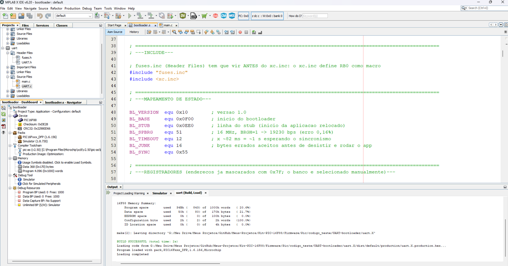
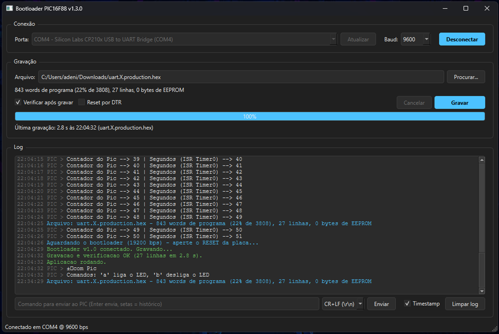

# PIC16F88 USB Bootloader

---

## Sumário

- [Histórico de Versão](#histórico-de-versão)
- [Resumo](#resumo)
- [Objetivo](#objetivo)
- [Requisitos](#requisitos)
- [Informações Adicionais](#informações-adicionais)
  - [Firmware](#firmware)
  - [Software](#software)

## Histórico de Versão

| Versão | Data       | Autor       | Descrição                                                        |
|--------|------------|-------------|------------------------------------------------------------------|
| 1.0.0  | 15/11/2026 | Adenilton R | Publicação do projeto no GitHub (firmware 1.1.0, software 1.4.0) |

---

## Resumo

Bootloader UART para o **PIC16F88**, escrito em assembly e com apenas **256 words**. Grave seus programas pela **USB**, usando um adaptador USB-serial (CP210x, CH340, FT232), **sem precisar do PICkit**. Inclui um gravador para PC com **interface gráfica (PyQt6)**, que segue o tema claro/escuro do Windows, e **modo terminal**.

## Objetivo

- Gravar o PIC16F88 pela USB, usando só o conversor USB-serial da placa. O PICkit é usado **uma única vez**, para gravar o bootloader.
- Manter o app em C (XC8) **sem mudanças no código**: o vetor de interrupção `0x0004` continua sendo do app. Só é preciso reservar a ROM no linker.
- Gravar com segurança:
  - linha a linha (32 words), com checksum e verificação por leitura;
  - o bootloader não deixa sobrescrever a própria área;
  - se a gravação for interrompida, o PIC fica no bootloader em vez de rodar um app pela metade.
- Oferecer um gravador simples no PC: interface gráfica com monitor serial, modo terminal (CLI) e executável `.exe`.

## Requisitos

**Hardware**

- PIC16F88 com cristal de **16 MHz** (HS);
- adaptador USB-serial (CP210x, CH340, FT232). O Kit PIC16F88 já tem o CP2102;
- PICkit 3 (ou outro gravador ICSP), só para gravar o bootloader a primeira vez.

**Software**

- MPLAB X com **XC8 2.50** (inclui o assembler **pic-as**);
- Python **3.11+** com `PyQt6` e `pyserial` (veja `software/requirements.txt`). Se usar o `.exe`, o Python não é necessário.

## Informações Adicionais

### Firmware

Para obter mais informações sobre o projeto do Firmware (bootloader, fuses, app de exemplo, mapa de memória, protocolo, fluxogramas e log de bancada), clique no [**link**](firmware/README.md) a seguir.

### Software

Para obter mais informações sobre o projeto do Software (instalação, interface gráfica, terminal e geração do `.exe`), clique no [**link**](software/README.md) a seguir.

