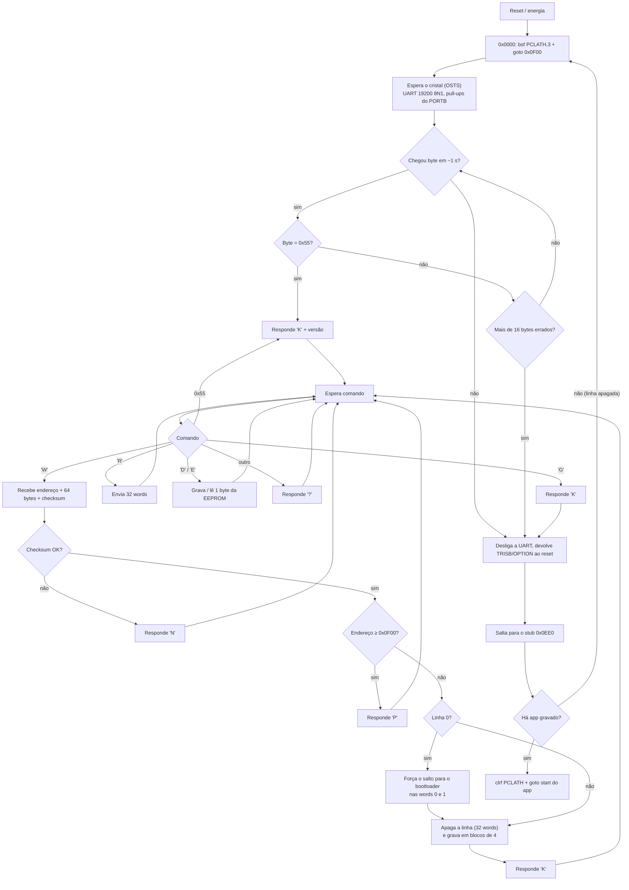
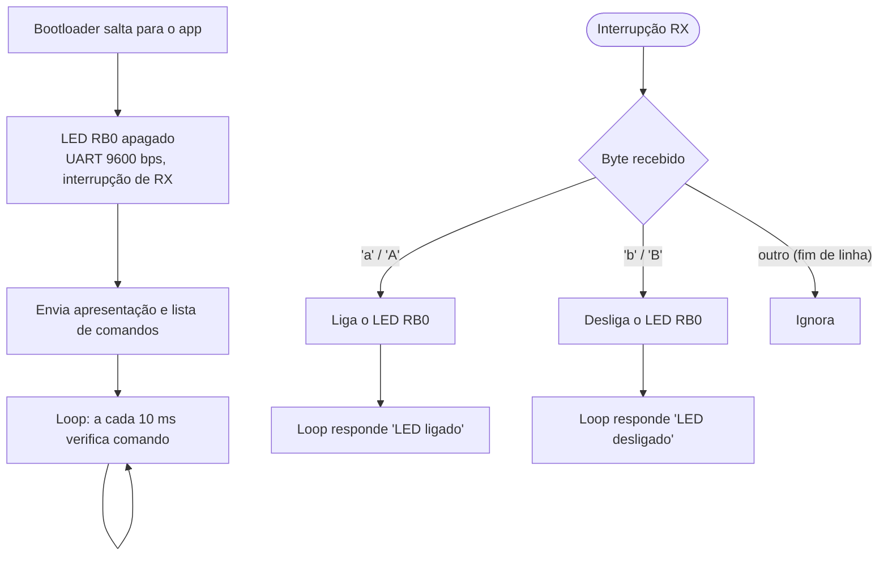
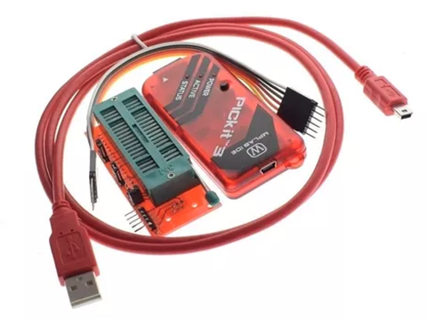
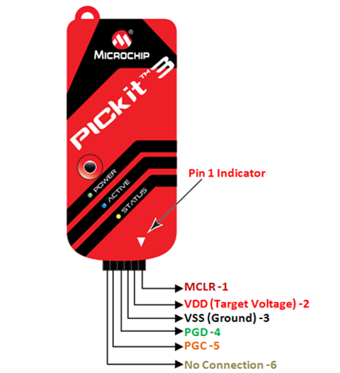
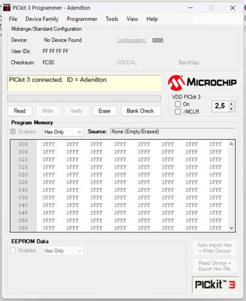
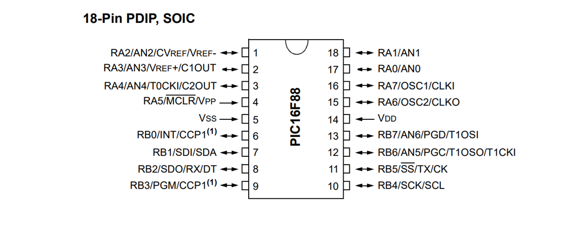
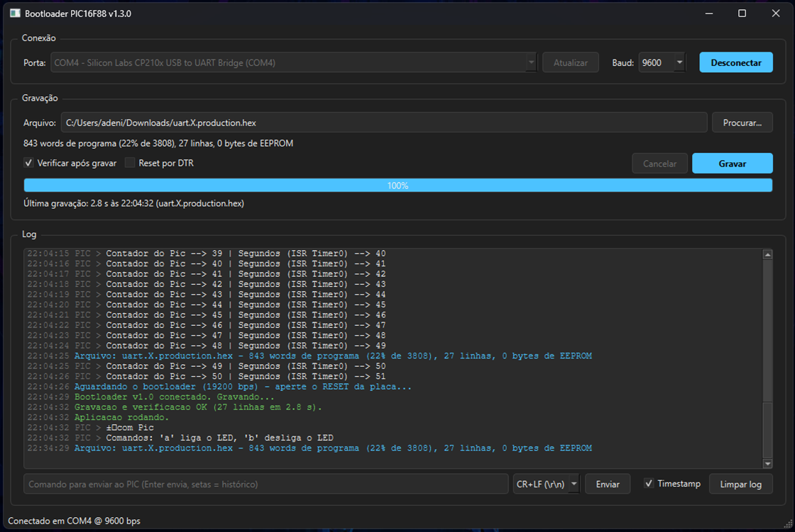

# _Firmware - Bootloader UART_


---

## Sumário

- [Histórico de versão](#histórico-de-versão)
- [Resumo](#resumo)
- [Links para estudos](#links-para-estudos)
- [Fluxograma](#fluxograma)
- [Configuração do Gravador PICKIT3](#configuração-do-gravador-pickit3)
- [PIC16F88](#pic16f88)
- [Pinos do projeto eletrônico](#pinos-do-projeto-eletrônico)
- [Bibliotecas](#bibliotecas)
- [Configuração do Firmware](#configuração-do-firmware)
- [Mapa de memória](#mapa-de-memória)
- [Protocolo (UART 19200 8N1)](#protocolo-uart-19200-8n1)
- [Informações](#informações)

## Histórico de versão

| Versão | Data       | Autor       | Descrição |
|--------|------------|-------------|-----------|
| 1.0.0  | 14/11/2026 | Adenilton R | Início do projeto: bootloader UART para o PIC16F88 (gravação pela USB, sem PICkit) |
| 1.1.0  | 15/11/2026 | Adenilton R | Finalização do firmware: bootloader em assembly (pic-as) em 0x0F00-0x0FFF com fuses em `fuses.inc`, validado na placa com CP210x; app de exemplo uart.X (comandos `a`/`b` para o LED, ISR nativa) |

## Resumo

Bootloader serial para gravar o PIC16F88 do Kit pela USB, sem PICkit. O PIC16F88 não tem USB, então a gravação usa um adaptador USB-serial (CP210x, CH340, FT232) ligado na UART do PIC (RB2/RB5) e um gravador no PC (interface gráfica ou terminal) que lê o .hex gerado pelo MPLAB X, grava, verifica e roda o app.

O bootloader é escrito em assembly (pic-as, que vem com o XC8 2.50) e fica no topo da flash (0x0F00-0x0FFF, 250 de 256 words). Ele fica no topo porque no PIC16F88 o vetor de interrupção é fixo em 0x0004 e não há salvamento automático de contexto: com o bootloader no início da flash, o redirecionamento da interrupção corromperia W/STATUS/PCLATH. Assim o app em C compila normalmente, com ISR nativa. A única mudança no app é reservar a ROM.

Ao ligar, o bootloader espera cerca de 1 s pelo PC. Se nada chegar, roda o app. O bootloader é gravado uma vez com o PICkit; depois disso, todos os apps vão pela serial.

## Links para estudos

[Informações do PIC16F88](https://www.microchip.com/en-us/product/pic16f88)

[Datasheet PIC16F88](https://ww1.microchip.com/downloads/aemDocuments/documents/MCU08/ProductDocuments/DataSheets/30487D.pdf)

[PICKIT3](https://www.microchip.com/en-us/development-tool/pg164130)

[pyserial (biblioteca serial do Python)](https://pypi.org/project/pyserial/)

## Fluxograma

### Bootloader (bootloader.s)



### App de exemplo (uart.X)



## Configuração do Gravador PICKIT3

O [**PICKIT3**](https://www.microchip.com/en-us/development-tool/pg164130) é um programador e depurador in-circuit (ICD) para microcontroladores PIC da Microchip. Ele grava o firmware e depura o código diretamente em microcontroladores PIC e dsPIC compatíveis.



Esquemático eletrônico:



**Informações Técnicas:**

- **`Comunicação com PC:`** Conectividade via USB 2.0;
- **`Tensão de operação:`** 3,3V ou 5V, dependendo do microcontrolador;
- **`Corrente máxima fornecida:`** Aproximadamente 30mA;
- **`Interface de programação:`** ICSP (In-Circuit Serial Programming) com conector de 6 pinos.
- `Compatibilidade de software:`
  - MPLAB X IDE;
  - MPLAB IPE;
  - Pode funcionar com softwares de terceiros através de firmware customizado.
- **Modos de operação**:
  - **`Programação:`** Gravação do firmware no microcontrolador;
  - **`Depuração:`** Permite análise de código em tempo real, breakpoint, inspeção de variáveis, etc.

Para instalar e configurar PICKIT3 siga os passos.



## PIC16F88

[O PIC16F88](https://www.microchip.com/en-us/product/pic16f88) é um microcontrolador da família PIC16 da Microchip, com arquitetura de 8 bits e um conjunto de periféricos integrados que o tornam versátil para diversas aplicações embarcadas. Possui recursos como USART, SPI, I²C, ADC, comparadores e PWM, sendo ideal para projetos de automação, sensores inteligentes e sistemas embarcados.

**Informações Técnicas:**

- `Família:` PIC16;
- `Arquitetura:` Harvard, 8 bits;
- `Memória Flash:` 7 KB (4K palavras);
- `SRAM:` 368 bytes;
- `EEPROM:` 256 bytes;
- `Clock máximo:` 20 MHz (com oscilador externo);
- `Ciclo de instrução:` 1 ciclo por 4 ciclos de clock.

**Periféricos e Funcionalidades:**

- `GPIOs:` 16 pinos de I/O (entrada/saída digital);
- `Conversor Analógico-Digital (ADC):` 7 canais de 10 bits;
- `PWM:` 1 módulo CCP (Capture/Compare/PWM);
- `Timers:` 3 (Timer0, Timer1 e Timer2);
- `Comparadores Analógicos:` 2 comparadores internos;
- `Watchdog Timer (WDT):` Sim;
- `Oscilador interno:` 8 MHz, com opção de ajuste por software.

**Comunicação:**

- `USART:` Suporte a comunicação serial (TX/RX);
- `SPI:` Suporte a barramento SPI;
- `I²C:` Escravo em hardware (módulo SSP); o modo mestre é feito por software.

**Alimentação e Consumo:**

- `Tensão de operação:` 2,0V a 5,5V.
- **Consumo em operação:**
  - 1,8 mA @ 5V, 4 MHz;
  - 100 nA no modo de baixo consumo (Sleep).

**Pinos ICSP:**

| Conector | Nome          | Pino |
|----------|---------------|------|
| 1        | MCLR/Vpp      | RA5  |
| 2        | VDD Target    | +5V  |
| 3        | VSS (ground)  | 0V   |
| 4        | PGD (ICSPDAT) | RB7  |
| 5        | PGC (ICSPCLK) | RB6  |
| 6        | PGM (LVP)     | RB3  |

## Pinos do projeto eletrônico



| Nome      | Pino |
|-----------|------|
| PIN_led   | RB0  |
| RX (UART) | RB2  |
| TX (UART) | RB5  |

**Ligação do adaptador USB-serial:**

| Adaptador USB-serial | PIC16F88                  |
|----------------------|---------------------------|
| TX                   | RB2 (pino 8) - RX do PIC  |
| RX                   | RB5 (pino 11) - TX do PIC |
| GND                  | GND                       |

Use um adaptador de 5 V. Os pull-ups internos do PORTB ficam ligados durante a espera do bootloader, então o RX não flutua sem o adaptador.

## Bibliotecas

O bootloader não usa bibliotecas. O app de exemplo (uart.X) usa a biblioteca UART.c/UART.h do exemplo UART. O uploader do PC usa o pyserial (pip install pyserial).

- [`uart.X/main.c`](uart.X/main.c): app de exemplo v1.2.1 (UART a 9600 bps; `a` liga o LED em RB0 e `b` desliga, recebidos pela interrupção de RX).
- [`bootloader.X/bootloader.s`](bootloader.X/bootloader.s): bootloader completo.
- [`bootloader.X/fuses.inc`](bootloader.X/fuses.inc): bits de configuração (fuses) do PIC16F88, incluídos pelo `bootloader.s` (Header Files).
- [`software/`](../software/README.md): gravador do PC, com interface gráfica (PyQt6, `main.py`) e modo terminal (`scripts/pic16f88_boot.py`). Ele lê o .hex, valida o tamanho, reloca o vetor de reset do app para o stub (0x0EE0), grava linha a linha, verifica lendo de volta e roda o app.

## Configuração do Firmware

Configuração do Ambiente de Desenvolvimento para PIC16F88. Para desenvolver e testar código para o **PIC16F88**, siga os passos abaixo para configurar o ambiente de desenvolvimento:

[**`Instalando as Ferramentas Necessárias`**](https://github.com/AdeniltonR/Exemplos-de-firmware-para-PIC)

Você precisará dos seguintes softwares:

- **MPLAB X IDE** – Ambiente de desenvolvimento integrado (IDE) da Microchip.
- **Compilador XC8** – Compilador C para microcontroladores PIC (inclui o assembler **pic-as**, usado no bootloader).
- **Python 3 + PyQt6 + pyserial** – Para o gravador do PC (ver [software/README.md](../software/README.md)).

Baixe as ferramentas no site oficial da Microchip e instale seguindo as instruções fornecidas.

[**`Criando projeto e configurando fuses`**](https://github.com/AdeniltonR/Exemplos-de-firmware-para-PIC/blob/main/Familia%20PIC/PIC18F47K40/README.md)

> O guia acima usa o PIC18F47K40 como exemplo, mas os passos no MPLAB X são os mesmos para o PIC16F88: basta escolher o PIC16F88 como dispositivo.

**Estrutura do Projeto:**

A pasta `firmware` tem o projeto do bootloader (pic-as) e o app de exemplo (XC8). O gravador do PC fica em `software`.

```txt
pic16f88-usb-bootloader/
│
├── docs/                                  # Imagens da documentação (PICKIT3, pinout, tela do software)
│
├── firmware/
│   ├── bootloader.X/                      # Projeto MPLAB X do bootloader (toolchain pic-as)
│   │   ├── bootloader.s                   # Bootloader completo (250 de 256 words) - Source Files
│   │   └── fuses.inc                      # Bits de configuração (fuses) - Header Files
│   │
│   ├── uart.X/                            # App de exemplo (C/XC8): comandos a/b pela serial (9600 bps) para o LED (RB0)
│   │   ├── main.c
│   │   ├── UART.c / UART.h                # Biblioteca UART
│   │   └── nbproject/configurations.xml   # ROM ranges = default,-EE0-FFF
│   │
│   └── README.md                          # Este arquivo
│
├── software/                              # Gravador do PC (ver software/README.md)
│   ├── main.py                            # Interface gráfica (PyQt6)
│   └── scripts/pic16f88_boot.py           # Modo terminal
│
├── LICENSE
└── README.md
```

**Configurar o projeto do bootloader (bootloader.X):**

1. Project Properties > Conf: default > Compiler Toolchain: selecione **pic-as (v2.50)**.
2. Adicione `bootloader.s` em Source Files e `fuses.inc` em Header Files, confirme o dispositivo PIC16F88 e faça o Build.
3. Grave uma vez com o PICkit (Make and Program Device).

Os bits de configuração (HS, WDT off, **WRT off**...) ficam no `fuses.inc` e vêm do bootloader. O `fuses.inc` usa a diretiva CONFIG do pic-as (não é o #pragma config do C) e é incluído antes do `#include <xc.inc>`. O app não consegue alterá-los pela serial: o `#pragma config` do app é ignorado e o uploader avisa se for diferente.

**Configurar cada app em C:**

Project Properties > XC8 Linker > Memory model > ROM ranges = `default,-EE0-FFF`. Isso deixa 3808 words (0x0000-0x0EDF) para o app. Não adicione o bootloader em Loadables: o endereço 0 dos dois .hex conflita e o stub só é montado pelo uploader.

**Gravar pelo PC:** pela interface gráfica (`python main.py`) ou pelo terminal (Git Bash). A instalação (venv, PyQt6, pyserial) está em [software/README.md](../software/README.md).



```bash
cd pic16f88-usb-bootloader/software
source venv/Scripts/activate
python main.py
winpty python scripts/pic16f88_boot.py -p COM4 ../firmware/uart.X/dist/default/production/uart.X.production.hex --monitor 9600
```

Ao gravar, aperte o RESET da placa quando pedir. O script tenta conectar por 15 s (`-t`), grava, verifica e roda o app. O `winpty` é necessário no Git Bash para o monitor mostrar a saída e aceitar Ctrl+C. Outras opções: `--no-verify`, `--no-run`, `-b` (baud do bootloader), `--dtr-reset`.

## Mapa de memória

| Endereço (words) | Conteúdo                                                                                          |
|------------------|---------------------------------------------------------------------------------------------------|
| 0x0000-0x0001    | bsf PCLATH,3 + goto 0x0F00: salto para o bootloader (o bootloader força isso ao gravar a linha 0) |
| 0x0002-0x0EDF    | Aplicação. O vetor de interrupção 0x0004 continua sendo do app                                    |
| 0x0EE0-0x0EFF    | Stub: clrf PCLATH + as 2 words originais do reset do app (montado pelo uploader)                  |
| 0x0F00-0x0FFF    | Bootloader (protegido: escritas retornam 'P')                                                     |

- O XC8 gera o vetor de reset em 2 words (bcf/bsf PCLATH,3 + goto start) e já coloca código em 0x0002. Por isso só 2 words são relocadas.
- O stub ocupa uma linha própria de 32 words, porque o apagamento do PIC16F88 é por linha. Regravar o stub nunca apaga código do bootloader.
- Sem app (stub apagado = 0x3FFF), a execução percorre a linha apagada e cai de volta em 0x0F00: o PIC fica no bootloader.

## Protocolo (UART 19200 8N1)

| Comando (PC → PIC)    | Resposta           | Efeito                                                           |
|-----------------------|--------------------|------------------------------------------------------------------|
| 0x55                  | 'K', versão (0x10) | Sincronismo. Na partida, se nada chegar em ~1 s, roda o app      |
| 'W' aH aL d0..d63 chk | 'K' / 'N' / 'P'    | Apaga e grava 32 words (linha) em aH:aL                          |
| 'R' aH aL             | 64 bytes           | Lê 32 words                                                      |
| 'D' a d chk           | 'K' / 'N'          | Grava 1 byte na EEPROM de dados                                  |
| 'E' a                 | 1 byte             | Lê 1 byte da EEPROM de dados                                     |
| 'G'                   | 'K'                | Desliga a UART, devolve TRISB/OPTION ao reset e salta para o app |
| outro                 | '?'                | -                                                                |

- Words em little-endian, como no .hex. chk: a soma de todos os bytes após o comando (incluindo chk) é 0 mod 256. 'N' = checksum errado, 'P' = endereço ≥ 0x0F00.
- Ordem de gravação no uploader: (1) apaga o stub, (2) grava o app, (3) grava a EEPROM, (4) grava o stub. Se a gravação for interrompida, o PIC fica no bootloader em vez de rodar um app pela metade.

## Informações

| Info                   | Modelo                                                  |
|------------------------|---------------------------------------------------------|
| uC                     | PIC16F88                                                |
| Placa                  | Kit PIC16F88                                            |
| Arquitetura            | RISC                                                    |
| IDE                    | MPLAB X IDE v6.20                                       |
| Compilador             | XC8 v2.50                                               |
| Assembler (bootloader) | pic-as (XC8 v2.50)                                      |
| Oscilador              | Cristal 16 MHz (HS)                                     |
| Adaptador USB-serial   | CP210x (testado), CH340, FT232                          |
| Gravador do PC         | Python 3 + PyQt6 + pyserial (ou BootloaderPIC16F88.exe) |
