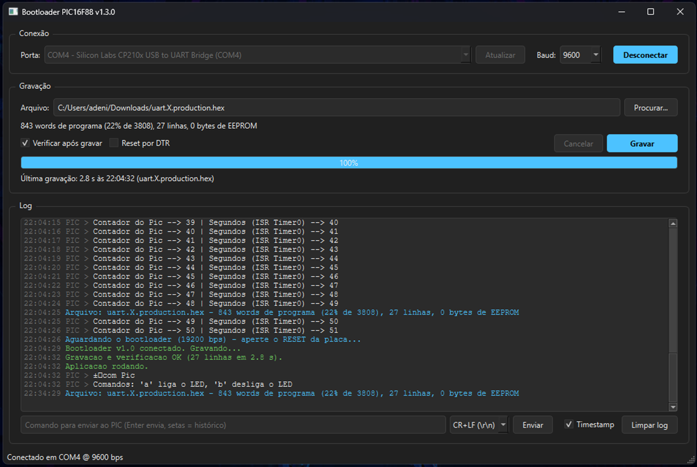
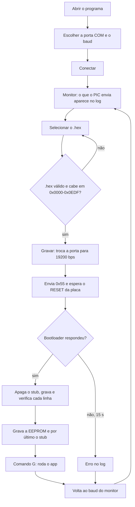

# _Software - Bootloader_


---

## Sumário

- [Histórico de versão](#histórico-de-versão)
- [Introdução](#introdução)
- [Objetivo](#objetivo)
- [Estrutura do Projeto](#estrutura-do-projeto)
- [Links de Estudo](#links-de-estudo)
- [Fluxograma](#fluxograma)
- [Instale Git](#instale-git)
- [Ambiente Virtual com venv](#ambiente-virtual-com-venv)
- [Configuração de Software](#configuração-de-software)
- [Informações](#informações)

## Histórico de versão

| Versão | Data       | Autor       | Descrição |
|--------|------------|-------------|-----------|
| 1.0.0  | 14/11/2026 | Adenilton R | Início do projeto: gravador do PC para o bootloader UART do PIC16F88 |
| 1.4.0  | 15/11/2026 | Adenilton R | Finalização do software: interface gráfica PyQt6 (tema do Windows, monitor serial, envio de comandos, timestamp, tempo da última gravação), modo terminal e executável via `build_exe.bat` |

## Introdução

Gravador para o bootloader UART do PIC16F88 do Kit. Ele grava pela USB, usando um adaptador USB-serial (CP210x, CH340, FT232), o .hex gerado pelo MPLAB X, sem PICkit.

## Objetivo

Oferecer duas formas de gravar, com o mesmo núcleo:

- **Interface gráfica (PyQt6)**: escolher a porta COM (com botão Atualizar), conectar, escolher o baud do monitor, selecionar o .hex, gravar com barra de progresso e ver tudo num log. O log também mostra o que o PIC envia pela serial. A janela segue o tema do Windows (claro ou escuro) e troca sozinha se o tema mudar com o programa aberto.
- **Terminal (Git Bash / cmd)**: `scripts/pic16f88_boot.py`, para gravar por linha de comando.



## Estrutura do Projeto

Aqui está uma visão geral da estrutura básica do projeto:

```txt
software/
├── README.md                        # Descrição do projeto e instruções de uso
├── main.py                          # Arquivo principal: abre a interface gráfica
├── requirements.txt                 # Dependências do projeto (PyQt6, pyserial)
├── build_exe.bat                    # Gera o executável dist/BootloaderPIC16F88.exe (PyInstaller)
├── src/                             # Módulos principais (como pacotes Python)
│   ├── bootloader/                  # Núcleo compartilhado (GUI e terminal)
│   │   ├── __init__.py
│   │   ├── hexfile.py               # Leitura do .hex, validação e relocação do vetor de reset
│   │   └── protocol.py              # Protocolo serial do bootloader (sincronismo, grava, lê, run)
│   ├── gui/                         # Interface gráfica (PyQt6)
│   │   ├── __init__.py
│   │   ├── main_window.py           # Janela: conexão, gravação, log e envio de comandos
│   │   ├── workers.py               # Threads: monitor serial e gravação
│   │   └── theme.py                 # Tema claro/escuro seguindo o Windows
│   └── utils/                       # Funções auxiliares
│       ├── __init__.py
│       └── helpers.py               # Configurações, log em arquivo, lista de portas
├── data/
│   └── logs/                        # Logs de cada dia (bootloader_AAAAMMDD.log)
├── config/
│   └── settings.json                # Baud do bootloader/monitor, última porta e último arquivo
└── scripts/
    └── pic16f88_boot.py             # Gravador pelo terminal
```

## Links de Estudo

[PyQt6](https://www.riverbankcomputing.com/static/Docs/PyQt6/)

[pyserial](https://pyserial.readthedocs.io/)

[Intel HEX](https://en.wikipedia.org/wiki/Intel_HEX)

[Datasheet PIC16F88 (seção 3: memória flash)](https://ww1.microchip.com/downloads/aemDocuments/documents/MCU08/ProductDocuments/DataSheets/30487D.pdf)

## Fluxograma



## Instale Git

No Windows, instale o [Git for Windows](https://git-scm.com/download/win), que já traz o **Git Bash**. Para garantir que o Git foi instalado corretamente, verifique a versão instalada com:

```bash
git --version
```

## Ambiente Virtual com venv

Para criar e gerenciar um ambiente virtual usando `venv`, siga os passos abaixo:

### Instale o Python

Instale o [Python 3.11 ou mais novo](https://www.python.org/downloads/) e marque **"Add python.exe to PATH"** no instalador. Confira no Git Bash:

```bash
python --version
```

### Crie um Ambiente Virtual

1. **Abra o Git Bash.**
2. Navegue até a pasta software:
   ```bash
   cd pic16f88-usb-bootloader/software
   ```
3. **Execute o Comando para Criar o Ambiente Virtual** (nome `venv`):
   ```bash
   python -m venv venv
   ```

### Ative o Ambiente Virtual

No Git Bash (Windows):

```bash
source venv/Scripts/activate
```

No cmd: `venv\Scripts\activate`. No Linux: `source venv/bin/activate`. O nome `(venv)` aparece no prompt quando o ambiente está ativo.

### Instale Pacotes

```bash
pip install -r requirements.txt
```

### Desative o Ambiente Virtual

```bash
deactivate
```

### Remover o Ambiente Virtual

Basta apagar a pasta `venv`:

```bash
rm -rf venv
```

### Notas Adicionais

- A pasta `venv` é local de cada máquina; não suba para o Git (já está no `.gitignore`).
- Se o projeto estiver numa pasta do **Google Drive**, prefira criar o venv fora dela (ex.: `python -m venv "$LOCALAPPDATA/BootloaderPIC16F88/venv"`): o Drive não sincroniza bem os milhares de arquivos do venv e pode corromper o pip (`No module named pip._vendor.rich`).
- Use `pip list` para listar os pacotes instalados.

### Pacotes Python

[PyQt6](https://pypi.org/project/PyQt6/), v6.5 ou mais novo (o tema automático do Windows usa recursos do Qt 6.5)

```bash
pip install PyQt6
```

[pyserial](https://pypi.org/project/pyserial/), v3.5

```bash
pip install pyserial
```

## Configuração de Software

**Antes de tudo:** o bootloader precisa estar gravado no PIC (uma vez, com o PICkit) e o app precisa ser compilado com ROM ranges `default,-EE0-FFF`. Detalhes no [README do firmware](../firmware/README.md).

### Opção 1: interface gráfica

```bash
source venv/Scripts/activate
python main.py
```

1. **Porta**: escolha a COM do adaptador (clique em **Atualizar** se você plugou depois de abrir o programa).
2. **Baud**: baud do **monitor**, ou seja, do que o app envia. O uart.X usa 9600.
3. **Conectar**: abre a porta, e tudo que o PIC enviar aparece no log com o prefixo `PIC >`.
4. **Procurar...**: selecione o .hex em `dist/default/production` (ou arraste o arquivo para a janela). O tamanho e os avisos aparecem no log. Se o app invadir a área do bootloader, o programa avisa e não deixa gravar.
5. **Gravar**: aperte o **RESET** da placa quando o log pedir. O programa troca para 19200 bps, grava, verifica e roda o app, e depois volta ao baud do monitor. **Cancelar** interrompe; o PIC fica no bootloader até o próximo reset. A barra mostra só a porcentagem. Abaixo dela aparecem o tempo, a hora e o arquivo da **última gravação** (fica salvo para a próxima vez que abrir o programa).
6. **Enviar comandos**: o campo embaixo do log manda texto para o PIC no baud do monitor. Escolha o fim de linha (Nenhum, LF, CR ou CR+LF), aperte Enter ou **Enviar**. O que foi enviado aparece no log com `TX  >`, e as setas para cima/baixo navegam no histórico. A caixa **Timestamp** liga/desliga a hora em cada linha do log (vale também para as linhas já mostradas).

Outros detalhes:

- **Tema**: segue o Windows (Configurações > Personalização > Cores > Modo do aplicativo) e troca na hora se você mudar.
- **Log em arquivo**: fica em `data/logs/bootloader_AAAAMMDD.log`.
- **Configurações**: `config/settings.json` guarda a última porta, o último arquivo, a última gravação, o fim de linha do envio e o baud do bootloader (`bootloader_baud`). Altere esse valor só se mudar o `BL_SPBRG` no bootloader.s.

### Gerar o executável (.exe)

Dê dois cliques no `build_exe.bat` (ou rode `./build_exe.bat` no Git Bash). Ele cria um `venv` próprio em `%LOCALAPPDATA%\BootloaderPIC16F88\venv` (no disco local, fora do Google Drive, que corrompe o venv), instala as dependências e o PyInstaller, e gera `dist/BootloaderPIC16F88.exe`. Os arquivos temporários do build também ficam em `%LOCALAPPDATA%`. Ao terminar, abre a pasta `dist`.

- O .exe é um arquivo único (~40-60 MB) e não precisa do Python instalado no computador onde vai rodar.
- `config/settings.json` e `data/logs/` ficam **ao lado do .exe**. Para levar para outro PC, copie o .exe (e a pasta `config`, se quiser manter as configurações).
- A primeira abertura demora alguns segundos, porque o executável se descompacta numa pasta temporária.
- Se o antivírus do Windows bloquear, é falso positivo comum em executáveis do PyInstaller: libere o arquivo ou gere de novo.
- As pastas `build/`, `dist/` e o `.spec` estão no `.gitignore`.

### Opção 2: terminal (Git Bash)

```bash
python scripts/pic16f88_boot.py --list
winpty python scripts/pic16f88_boot.py -p COM4 ../firmware/uart.X/dist/default/production/uart.X.production.hex --monitor 9600
```

Aperte o RESET da placa quando aparecer "Aguardando o bootloader". O `winpty` faz o monitor funcionar no Git Bash (saída em tempo real e Ctrl+C). Opções: `-b` (baud do bootloader), `-t` (espera pelo reset, padrão 15 s), `--no-verify`, `--no-run`, `--dtr-reset`, `--monitor BAUD`.

## Informações

| Software    | Versão                               |
|-------------|--------------------------------------|
| Python      | v3.11+ (testado em 3.13)             |
| PyQt6       | v6.5+                                |
| Pyserial    | v3.5                                 |
| PyInstaller | v6+ (só para gerar o .exe)           |
| Sistema     | Windows 10/11 (Linux não testado)    |
